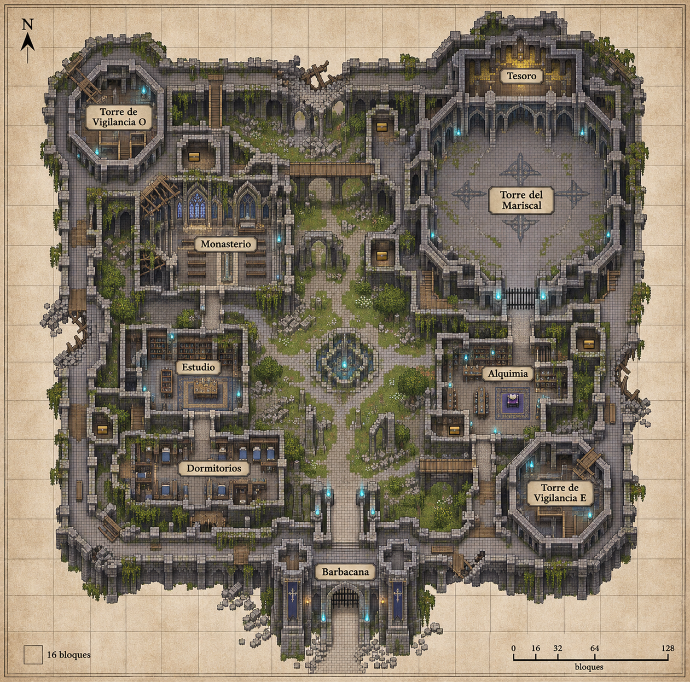

# V88 — Fortaleza de las Tres Torres

Elección del autor: **anillo de murallas rotas**, a partir del plano conceptual mostrado en la conversación. Esta entrega rediseña **Las Tres Torres Señoriales**. El Templo del Custodio conserva su forma honda de V70 hasta que el autor concrete qué quiere cambiar allí.



La ilustración orienta la distribución de salas; las coordenadas y cotas de esta página describen el plano que genera el mod.

## Planta y recorrido

Huella exacta: **128×128**, coordenadas relativas `x,z = −64…63`, entrada por el sur (`z = 62`). El origen y el controlador permanecen en `(0,0,0)`. No se cambian los ids `three_towers`, los jefes, el logro ni las recompensas existentes.

```text
                                  NORTE (z negativo)
         [Vigilancia O −43,−40]     [Tesoro 28,−58]
              │                    [Mariscal 28,−36]
         [Monasterio] ─── patio ────┤ entrada cerrada
         [Estudio]      │           [Alquimia]
         [Dormitorios]  └── adarve ─[Vigilancia E 43,41]
                         [Barbacana 0,62]
                                  SUR
```

| Zona | Planta/cota relativa | Acceso y función |
|---|---:|---|
| Barbacana | 0…12 | Entrada sur, paso de siete bloques, remate sobre el portón. |
| Muralla exterior | 0…11 | Anillo con tres brechas, almenas, adarve a +9 y cimiento. Las brechas no dan acceso al Mariscal. |
| Patio, caminos y puentes | 0…6; puentes +12 | Conectan ambos vigías, monasterio, estudio, dormitorios, alquimia y puerta del Mariscal; pasarelas de madera entre vigías y alas. |
| Monasterio | 0…10 | Nave arruinada, altar y campeón opcional al entrar; no desbloquea poder. |
| Estudio y dormitorios | 0…10 | Biblioteca y literas; cofres ocultos y un encuentro por sala. |
| Ala de alquimia | 0…10 | Soporte de pociones y mesa de encantamiento; cofre oculto y encuentro. |
| Vigilancia oeste y este | pisos 0, 6, 12; Guardián +18; techo +27; aguja +40 | Entradas independientes; oleadas únicas en tres plantas, Guardián en la superior. Orden libre. |
| Torre del Mariscal | pisos 0, 6, 12, 18; Coloso +24; techo +40; aguja +61 | Entrada sur de tres por tres cerrada hasta vencer a ambos Guardianes. Sala del Coloso de 37×37 interiores, 15 de alto bajo techo. |
| Cámara del tesoro | piso +24, techo +33 | Se abre al morir el Coloso. Aparecen hasta cinco cofres personales en `(28±2,25,−58)`. |

Los cofres de exploración usan una tabla moderada (`three_towers_supplies`): pan, hierro, libros, frascos de experiencia y fragmentos de alma. La Plantilla de ascensión garantizada y el botín mayor siguen exclusivamente tras el Coloso. El controlador marca como completados los encuentros de ala y no los repite tras recargar. Los estados de los tres jefes conservan sus ordinales; el indicador de fortaleza se guarda aparte y los controladores antiguos siguen usando `TowersLayout`.

## Generación por chunk

`FortressLayout` es puro y responde por celda/columna. `RegionGridPlacement` permite los **64 chunks** de un cuadrado de 8×8 alrededor del chunk designado en cada región de 24×24. El origen X/Z es la esquina de ese chunk designado. La designación deja cuatro chunks de margen en cada lado para que la fortaleza no invada la región vecina. Cada llamada al `Feature` escribe solo los 16×16 bloques de su chunk; el controlador y el índice se registran en el chunk del origen.

La altura y la admisión del sitio se calculan una vez por origen con el generador de terreno, se comparten durante la generación del mundo y no dependen del orden de los chunks. Se descartan columnas con fluido y sitios con desnivel mayor de **12**. La base se pone en la cota más alta; el cimiento rellena hacia abajo hasta 12 bloques. Una criba de 16 bloques entre muestras evita el examen completo en sitios obviamente inadecuados. `threeTowersEnabled` conserva su valor por defecto y la región de 24×24 sigue siendo más frecuente que el Templo (32×32).

El recuento del plano puro es de **9535 columnas ocupadas y 179 813 celdas escritas** antes del cimiento, repartidas entre los 64 chunks. La inspección de un candidato válido consulta como máximo dos alturas de terreno por columna ocupada, además de la criba; esta cifra es un presupuesto de operaciones, **no** una medida de tiempo de generación en Minecraft.

El controlador despierta criaturas solo cerca de jugadores. Un ciclo del servidor procesa la fortaleza aunque su chunk central no esté en la distancia de visión; el aviso de muerte carga ese chunk para conservar la derrota. `/aptitudes locate three_towers` sigue usando el índice, y `/aptitudes place three_towers` construye los chunks del plano en un sitio que supera el mismo filtro de terreno.

## Verificación pendiente en partida

1. Generar varias fortalezas en terreno llano y junto a agua/colinas. Comprobar que no hay cortes entre chunks, columnas flotantes, agua dentro ni secciones parciales.
2. Medir tiempo de generación y uso de memoria al explorar una región y al usar `/aptitudes place three_towers`; ajustar el coste si se observan pausas.
3. Subir a las dos torres sin saltos, desconectarse con un Guardián vivo y volver; confirmar que no se duplica ni pierde una derrota con el controlador fuera de la distancia de visión.
4. Probar la carga del Coloso en la sala alta y comprobar que ni su entidad ni sus golpes cruzan muros. La imagen conceptual no demuestra esa propiedad.
5. Vencer a ambos Guardianes, abrir la puerta del Mariscal, vencer al Coloso, entrar al tesoro y verificar hasta cinco cofres, logro y persistencia tras reiniciar.
6. Registrar el número de candidatos rechazados por el tope de desnivel para comprobar la frecuencia real. Esta implementación aún no se ha probado en partida.
